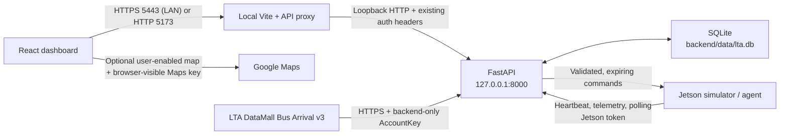

# System architecture

## Local process layout

The browser never connects directly to the Jetson. FastAPI owns the database, private LTA key, command queue, and authentication policy. The optional Google map uses a separate browser-visible restricted key, never an LTA or device credential. The app runs locally with no cloud deployment; map imagery and live LTA data require internet. There is no browser Web Bluetooth path.

The backend launch script binds to `127.0.0.1` by default. A Jetson on the same trusted Wi-Fi can reach it only when the operator deliberately starts it with `BACKEND_HOST=0.0.0.0` and configures the Jetson with the Mac's local Wi-Fi address.

The current local `.env` enables this LAN setting. The frontend startup script also listens on the LAN. Browser CORS origins remain explicitly listed in the backend configuration.

For browser location on LAN devices, `start-frontend-https.sh` serves HTTPS on
5443. Each device must trust the project-local CA. Relative API URLs are proxied
to loopback FastAPI, avoiding mixed content and remote-device localhost errors.
Backend authentication is unchanged. Private TLS keys live in ignored
`.local-https`, outside Vite's allowed filesystem root. See [local HTTPS](local-https.md).

## Bus-arrival flow

1. The user enters a five-digit bus stop code and, optionally, a bus service number.
2. React polls `GET /api/bus-arrivals?bus_stop_code=83139&service_no=15` every 20 seconds while visible. Changing the search cancels the old request and clears its results.
3. FastAPI validates the parameters and checks a stop/service-specific SQLite snapshot. A shared lock prevents simultaneous clients from duplicating provider calls. Results are reused for 20 seconds.
4. If needed, the backend makes one HTTPS call to LTA Bus Arrival v3 with its private `AccountKey` header. It validates LTA's response before saving it in `external_api_snapshots`.
5. React shows the next three arrival estimates. Dates are stored in UTC and displayed in Singapore time. Missing estimates remain missing. Failed refreshes keep the same search's last valid result with a stale warning and no live countdown.

This public read endpoint does not require operator/device credentials. Those credentials continue to protect commands, telemetry, and device operations. The most recent 1,000 bus snapshots are retained; other external snapshots are unaffected. See [lta-bus-arrivals.md](lta-bus-arrivals.md).

## Component responsibilities

### React frontend

- Poll FastAPI for status, external snapshots, devices, telemetry, and command history.
- Collect only structured `STOP`, `SET_MODE`, `SET_SPEED`, or `SEND_MESSAGE` requests.
- Confirm commands, prevent concurrent duplicate submissions, and disable controls when the backend or device is offline.
- Keep the operator token in browser session storage only.
- Never receive the private LTA API key or Jetson token. The optional Maps JavaScript API key is intentionally browser-visible and must be restricted to the allowed websites and Maps JavaScript API.
- Load Google Maps only on opt-in. Users' coordinates are not persisted or sent to FastAPI, but enabling the map gives them to Google's renderer.

Frontend validation improves usability but is not trusted as a safety boundary.

### FastAPI backend

- Authenticate operator actions separately from Jetson requests.
- Validate exact command payloads, numeric ranges, expiry, device ownership, and state transitions.
- Give STOP highest queue priority and atomically deliver each command once.
- Record command status history, heartbeats, receipt times, telemetry, and external snapshots.
- Return structured errors without logging secrets.
- Limit CORS to the configured frontend origins.

### SQLite

The default database is `backend/data/lta.db`; it is local and ignored by Git. Schema statements live in `backend/app/repositories/` and are collected by `backend/app/database.py`. Initialization is repeat-safe, foreign keys are enabled per connection, JSON is validated before storage, and timestamps use UTC.

### Jetson simulator / agent

- Send authenticated heartbeats and bounded simulated telemetry.
- Poll FastAPI over HTTP and validate device ID, UUID, type, exact payload, status, simulation flag, expiry, and duplicate IDs again.
- Acknowledge `running` before dispatch and `completed` or `failed` afterward.
- Select only allowlisted simulated handlers.
- Use bounded retry and enter safe/off state on communication loss or uncertainty.

`DRY_RUN` defaults to true. Both the agent and handler registry reject false because no hardware handler exists.

### Optional BLE transport

Wi-Fi/HTTP remains the active default. The repository contains an additive common transport interface, the existing Wi-Fi implementation, and a mock-only BLE protocol. If later verified, FastAPI will act as the BLE central/client through Bleak and the Jetson will expose a BlueZ GATT peripheral. The same command UUIDs, expiry, device authentication, independent validation, acknowledgements, and safe-state rules apply to either transport.

BLE is not connected to API routes yet because the Mac controller, exact Jetson, Jetson adapter, BlueZ version, and GATT/advertising interfaces could not be verified. See [bluetooth.md](bluetooth.md) for UUIDs, framing, inspection results, and the activation gate.

## Credentials and trust boundaries

| Caller | Credential | Allowed operations |
| --- | --- | --- |
| Browser/operator | `X-Operator-Token` | Refresh external data, queue/read commands, read devices and telemetry |
| Jetson agent | `X-Jetson-Token` | Send heartbeat/telemetry, poll commands, acknowledge status |
| Backend adapter | Provider API key | Call only the configured external provider |

The operator and Jetson tokens must be non-empty and different. Provider keys stay in `backend/.env`; no secret belongs in a `VITE_` variable.

## Command lifecycle

1. The operator confirms an allowlisted command in React.
2. The frontend single-flight gate sends one authenticated request to FastAPI.
3. FastAPI validates and stores it as `pending` with a unique request UUID and expiry.
4. Jetson polling atomically claims it as `delivered`; STOP is selected before normal commands.
5. The agent independently validates it and rejects stale or duplicate work.
6. The agent acknowledges `running`. If that acknowledgement fails, it does not run the handler.
7. A simulation-only handler produces a structured result while hardware outputs remain off.
8. The agent acknowledges `completed` or `failed`; FastAPI records the transition.
9. React polls and displays the stored command history.

Lifecycle statuses are `pending`, `delivered`, `running`, `completed`, `failed`, `expired`, and `cancelled`.

## Heartbeat and telemetry flow

FastAPI stores its UTC receipt time separately from the device timestamp. A device becomes offline after `JETSON_HEARTBEAT_TIMEOUT_SECONDS` (10 seconds by default), and telemetry becomes stale after `TELEMETRY_STALE_AFTER_SECONDS` (15 seconds by default). Missing readings remain missing rather than displaying as zero. History queries are capped and retention removes old records.

## Failure behavior

- Missing or incorrect credentials fail closed.
- Unknown, malformed, out-of-range, expired, stale, or duplicate commands are rejected.
- Temporary transport failures receive at most three attempts with bounded backoff.
- Communication loss, invalid input, handler failure, duplicate detection, and simulator shutdown activate safe/off state.
- Message text remains inert data; nothing is passed to a shell or code evaluator.
- Software STOP is not a physical emergency stop, and Wi-Fi is not a real-time control loop.

See [the safety checklist](safety-checklist.md) before every session and [the hardware-safety gate](hardware-safety.md) before proposing any physical output.
